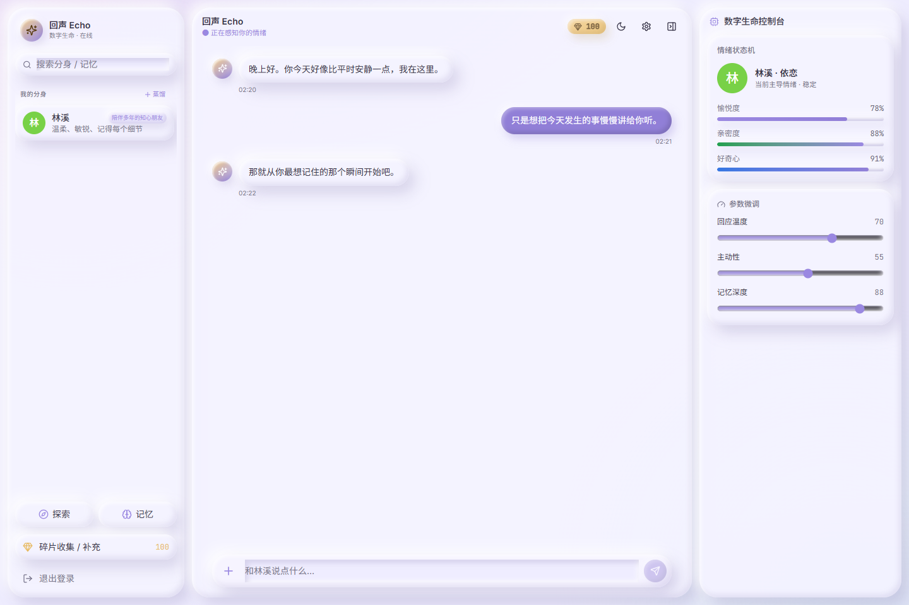
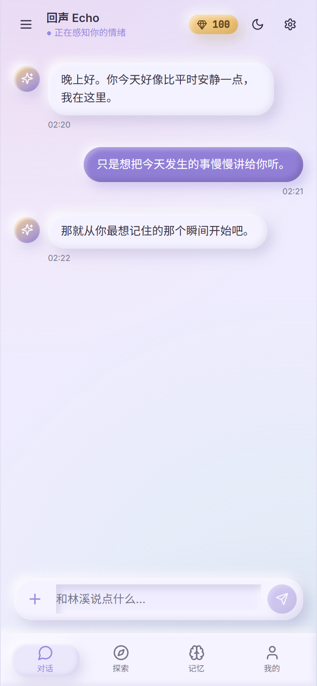
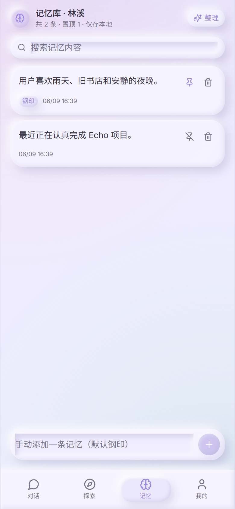
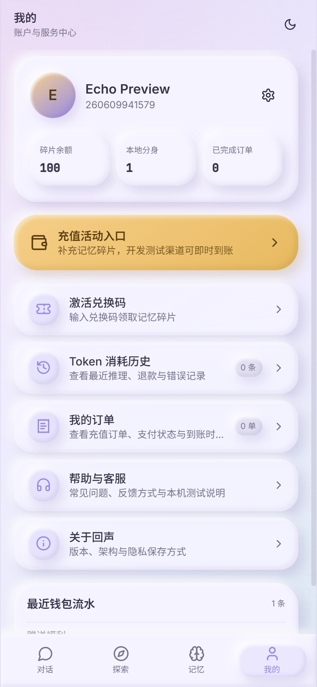
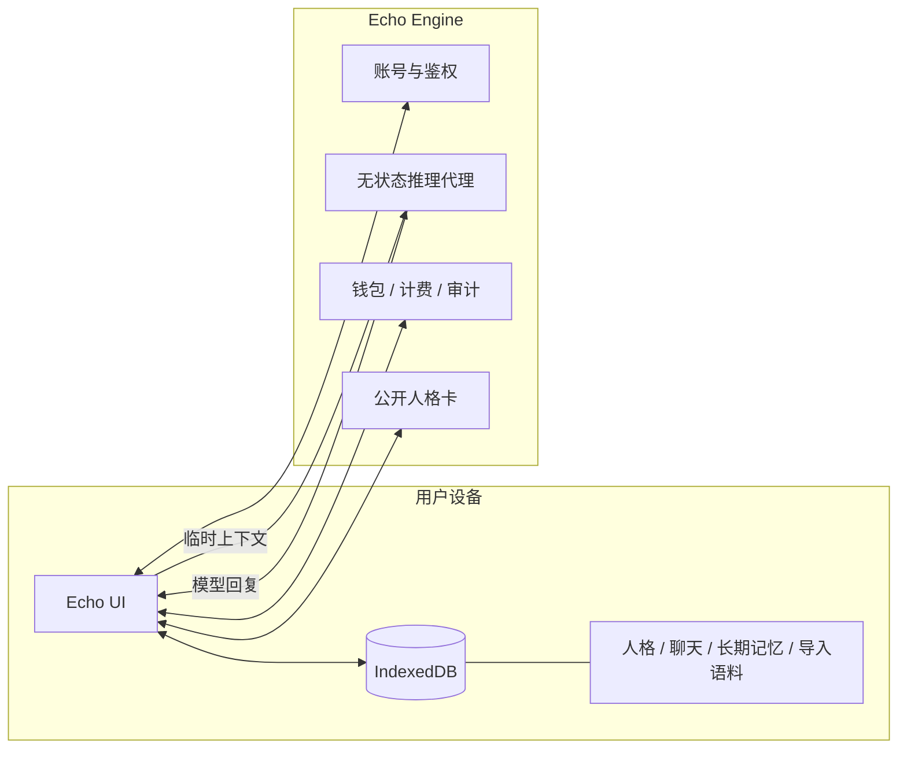
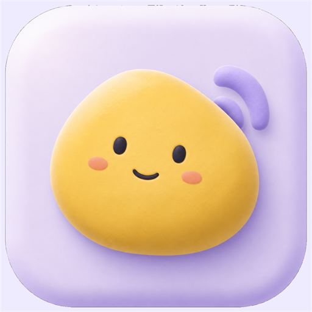

<div align="center">
  

  <h1>Echo 回声</h1>

  <p><strong>让记忆留在你的设备，让陪伴拥有时间。</strong></p>
  <p>一个本地优先、长期记忆驱动的数字生命与 AI 陪伴项目。</p>

  <p>
    <a href="#快速开始">快速开始</a> ·
    <a href="#新一代-clay-ui">界面预览</a> ·
    <a href="#隐私架构">隐私架构</a> ·
    <a href="Readme/ReadmeEnglish.md">English</a> ·
    <a href="Readme/ReadmeJapanese.md">日本語</a>
  </p>

  <p>
    
    
    
    
    
  </p>
</div>

<br />

<p align="center">
  
</p>

> [!NOTE]
> Echo 仍处于积极开发阶段。聊天、人格和长期记忆默认保存在用户设备本地；服务端负责账号、推理代理、计费、审计与公开人格卡，不持久化完整私有聊天记录。

## 为什么是 Echo

多数 AI 聊天产品把记忆交给云端。Echo 选择了另一条路：

- **记忆属于用户**：人格、聊天记录、长期记忆和导入语料默认保存在本地 IndexedDB。
- **上下文按需发送**：每次推理仅发送当前请求所需的最近对话与召回记忆。
- **陪伴持续生长**：情绪状态、关系参数、记忆结晶与人格设定共同塑造长期体验。
- **一套体验，多端运行**：React 前端可运行于 Web、Electron、Android 与 iOS。
- **可观察、可管理**：钱包、消耗、退款、订单、探索分享与后台管理均有明确边界。

## 新一代 Clay UI

新 UI 位于 [`Echo-Clay-UI/`](Echo-Clay-UI/)，在保留现有完整业务能力的基础上，以柔和光影、黏土触感与物理按压反馈重新设计交互。首次启动默认浅色主题，也支持持久化深色主题。

<table>
  <tr>
    <td align="center"></td>
    <td align="center"></td>
    <td align="center"></td>
  </tr>
  <tr>
    <td align="center"><strong>自然对话</strong><br /><sub>关系感知、情绪反馈与本地历史</sub></td>
    <td align="center"><strong>本地记忆</strong><br /><sub>搜索、钢印、整理与删除</sub></td>
    <td align="center"><strong>账户与服务</strong><br /><sub>碎片、兑换码、用量与订单</sub></td>
  </tr>
</table>

## 核心能力

| 能力 | 当前实现 |
| --- | --- |
| 数字生命 | 创建分身、头像、预设人格、关系描述、核心记忆与参数微调 |
| 长期对话 | 本地聊天历史、记忆召回、动态人格提示词与情绪状态更新 |
| 记忆系统 | 本地搜索、添加、钢印、删除、自动结晶与手动整理 |
| 聊天导入 | 微信/QQ 文本导入；Android 支持设备端离线中文 OCR |
| 探索广场 | 发布与安装公开人格卡，不上传私有聊天和记忆库 |
| 账户系统 | 注册、登录、删除账号、钱包、订单、用量、退款与兑换码 |
| 平台治理 | 管理后台、模型与定价配置、审计记录、敏感词双重过滤 |
| 多端体验 | Web、Electron、Android、iOS/Capacitor；中文与 English |

## 隐私架构



| 默认保存在本地 | 服务端保存 | 默认不上传 |
| --- | --- | --- |
| 人格、聊天、长期记忆、导入语料、OCR 结果 | 账号、钱包、订单、消耗元数据、公开人格卡、兑换码状态 | 完整聊天全文、私有记忆库、原始聊天导出文件 |

## 技术栈

| 层级 | 技术 |
| --- | --- |
| Clay 前端 | Vite、React、TypeScript、Tailwind CSS、Framer Motion、Zustand |
| 本地数据 | IndexedDB、`idb`、本地 RAG 与 Janitor |
| 移动端 | Capacitor 6、Android、iOS、ML Kit OCR |
| 桌面端 | Electron |
| 服务端 | Python、FastAPI、SQLAlchemy、PostgreSQL / SQLite |
| 部署 | Docker Compose、Caddy |

## 快速开始

### 运行新 Clay UI

```powershell
git clone https://github.com/ecokater/Echo.git
cd Echo
git checkout refactor/architecture

cd Echo-Clay-UI
npm install
npm.cmd run dev
```

打开 `http://127.0.0.1:4174`。

### 启动后端

```powershell
cd Echo/echo-engine
python -m venv venv
.\venv\Scripts\Activate.ps1
pip install -r requirements.txt
python main.py
```

后端默认监听 `http://127.0.0.1:8000`。生产环境变量与部署说明见 [Backend Guide](Readme/BACKEND_GUIDE.md)。

### 常用验证

```powershell
# Clay UI
cd Echo-Clay-UI
npx.cmd tsc --noEmit -p tsconfig.app.json
npm.cmd run build
npm.cmd run android:check
npm.cmd run android:build

# Backend
cd ../Echo/echo-engine
python -m compileall .
```

## 平台构建

| 平台 | 状态 | 入口 |
| --- | --- | --- |
| Web | 可构建 | `Echo-Clay-UI/` 或 `回声Echo数字生命UI/` |
| Android | Debug APK 已验证 | `npm.cmd run android:build` |
| iOS | 工程已生成，待 Mac 首次编译验收 | [iOS Mac Handoff](回声Echo数字生命UI/ios/IOS_MAC_HANDOFF.md) |
| Electron | 已接入 | `electron-main.cjs` |
| 服务端 | 可本地运行 / Docker 部署 | `Echo/echo-engine/`、`deploy/` |

Android Debug APK 输出：

```text
Echo-Clay-UI/android/app/build/outputs/apk/debug/app-debug.apk
```

> [!IMPORTANT]
> Release 与 App Store / 应用商店版本必须使用真实 HTTPS/WSS API。iOS 虚拟商品必须使用 Apple IAP，包内不能以微信或支付宝绕过 App Store 支付。

## 项目结构

```text
Echo-Clay-UI/                   新一代完整功能 Clay UI
回声Echo数字生命UI/             现有 Vite + React + Capacitor/Electron UI
Echo/echo-engine/              FastAPI 后端
Echo/main_ui/                  早期 Next.js + Electron 桌面 UI
deploy/                        Docker Compose / Caddy 部署
docs/                          架构、移动端与重构规划
Readme/                        多语言与开发指南
用户需求.md                     产品需求与验收标准
work.md / working.md           Codex 与 Claude 协作日志
```

## 路线图

- [x] 本地优先人格、聊天与长期记忆
- [x] 无状态推理代理、钱包、用量与退款审计
- [x] 探索人格卡、兑换码、管理后台与双重敏感词过滤
- [x] Android Debug 构建与设备端离线 OCR
- [x] 完整功能 Claymorphism 新 UI
- [ ] 新 UI 真实账号全链路验收
- [ ] iOS 模拟器、真机与 TestFlight 验收
- [ ] Apple IAP、微信/支付宝正式支付渠道
- [ ] HTTPS 域名、发布签名与商店合规材料

## 文档

- [快速开始](Readme/QUICK_START.md)
- [前端指南](Readme/FRONTEND_GUIDE.md)
- [后端指南](Readme/BACKEND_GUIDE.md)
- [移动端构建](docs/MOBILE_BUILD.md)
- [多平台规划](docs/MULTIPLATFORM_PLAN.md)
- [iOS Mac 接手指南](回声Echo数字生命UI/ios/IOS_MAC_HANDOFF.md)

## 合规与责任

- 导入聊天记录、创建他人分身或使用肖像、声音、文本资料前，应取得相关权利人的明确授权。
- 不得将 Echo 用于诈骗、冒充、骚扰、侵犯隐私、侵犯名誉或传播违法内容。
- 当前敏感词系统属于基础防线；正式商业上线前仍需完善内容安全、隐私政策、用户协议、数据删除与安全审计。
- 国内公开运营还需结合实际业务评估 App 备案、算法备案、生成式 AI 与支付相关要求。

## 参与项目

Echo 由 [ecokater](https://github.com/ecokater) 发起并维护。欢迎通过 [Issues](https://github.com/ecokater/Echo/issues) 提交建议、问题与设计反馈。

早期灵感与参考：

- [notdog1998/yourself-skill](https://github.com/notdog1998/yourself-skill)
- [LC044/WeChatMsg](https://github.com/LC044/WeChatMsg)

<div align="center">
  <br />
  
  <p><sub>Echo 回声 · Your memories stay with you.</sub></p>
</div>
