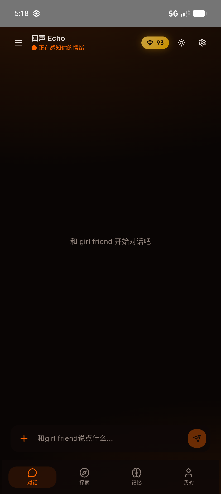
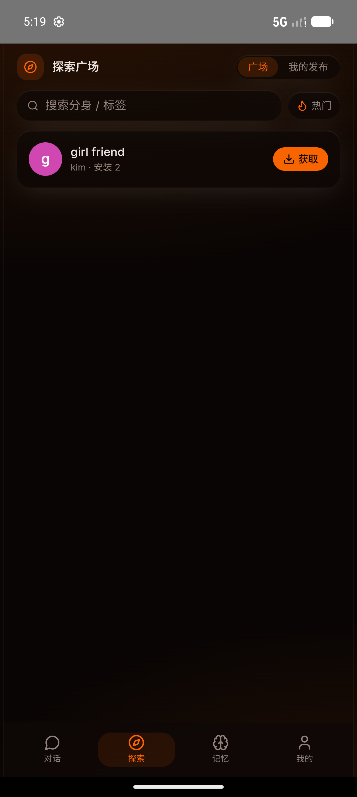
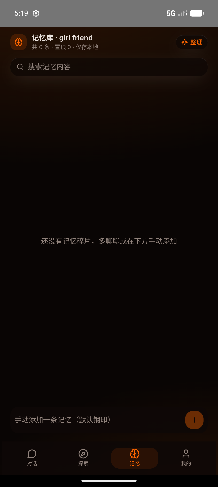
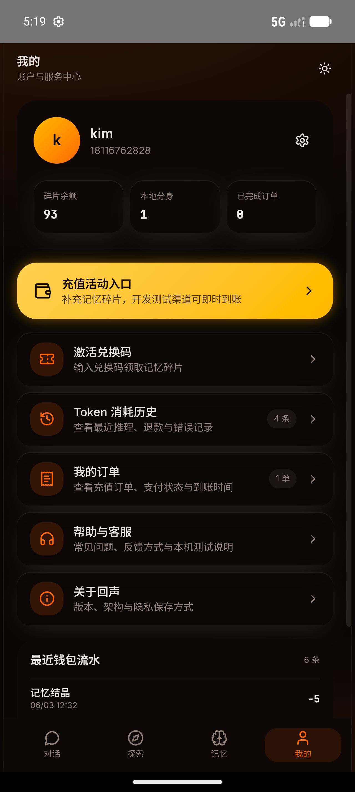
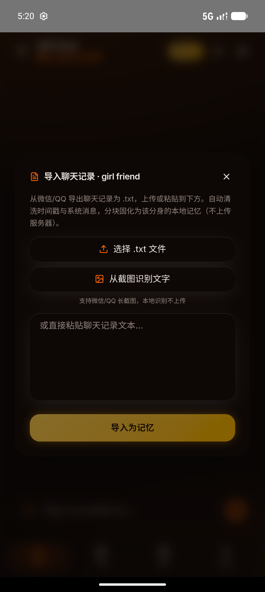

# Echo 回声

Echo はローカルファーストのデジタルライフ・コンパニオンアプリです。人格、会話履歴、プライベートな記憶、インポートした会話データを原則としてユーザー端末内に保存し、推論に必要な一時コンテキストだけをサーバーへ送信します。

プロジェクト名は現在 **Echo 回声** に統一されています。一部のフォルダ名には互換性維持のため過去の名称が残っていますが、現在の製品名は Echo です。

## リンク

- [简体中文](ReadmeChinese.md)
- [English](ReadmeEnglish.md)
- [Quick Start](QUICK_START.md)
- [Backend Guide](BACKEND_GUIDE.md)
- [Frontend Guide](FRONTEND_GUIDE.md)

## 実機スクリーンショット

以下は現在の Android Echo debug ビルド、パッケージ `com.echo.app` から取得した画像です。

  
  
  

  
  

## 主な機能

- ローカルファースト：人格、会話、長期記憶、インポート語料は端末内 IndexedDB に保存。
- ステートレス推論プロキシ：サーバーは一時コンテキストのみを受け取り、完全な会話履歴や私的記憶を永続化しません。
- マルチプラットフォーム：同じ React/Vite アプリを Web、Electron、Android Capacitor で利用。
- 長期記憶管理：閲覧、検索、固定、削除、手動追加、自動要約に対応。
- 会話記録インポート：WeChat/QQ の `.txt`、貼り付けテキスト、Android のローカル OCR によるスクリーンショット認識に対応。
- 探索広場：公開人格カードを共有し、他ユーザーがローカルに取得可能。
- ウォレットと交換コード：管理者がコードを生成し、ユーザーは「マイページ」で有効化。
- 多言語：中文/English の切り替え。
- セーフティ基盤：フロントエンドの敏感語ブロックと、課金前のバックエンド再検査。
- 管理ダッシュボード：利用量、注文、共有審査、モデル価格、交換コード管理。

## データ境界

| データ | 保存場所 |
|--------|----------|
| 人格、会話、私的記憶、インポート語料 | ユーザー端末 |
| OCR 認識結果 | ユーザー端末 |
| アカウント、ウォレット、注文、利用監査 | サーバー |
| 探索広場の人格カード | サーバー、ユーザーが明示的に公開したフィールドのみ |
| 交換コード状態 | サーバー |

Echo は完全な会話履歴や私的記憶をクラウドに永続化しません。推論時には、現在の応答に必要な一時コンテキストだけを送信します。

## 技術スタック

- Frontend: Vite, React, TypeScript, Tailwind CSS, Capacitor, Electron
- Local data: IndexedDB
- Backend: FastAPI, SQLAlchemy, SQLite/PostgreSQL
- Inference: OpenAI-compatible APIs, default SiliconFlow + `deepseek-ai/DeepSeek-V4-Pro`
- Android OCR: bundled ML Kit Chinese text recognizer, offline-capable

## Contributor

現在のメンテナー / コントリビューター：

- ecokater

## コンプライアンス

Echo は beta 段階の研究・個人利用向けプロジェクトです。会話記録のインポート、他者を元にした人格作成、肖像や個人情報の利用を行う前に、必ず権利者の明確な許可を取得してください。なりすまし、詐欺、嫌がらせ、プライバシー侵害、名誉毀損、違法コンテンツの生成や拡散に使用してはいけません。
